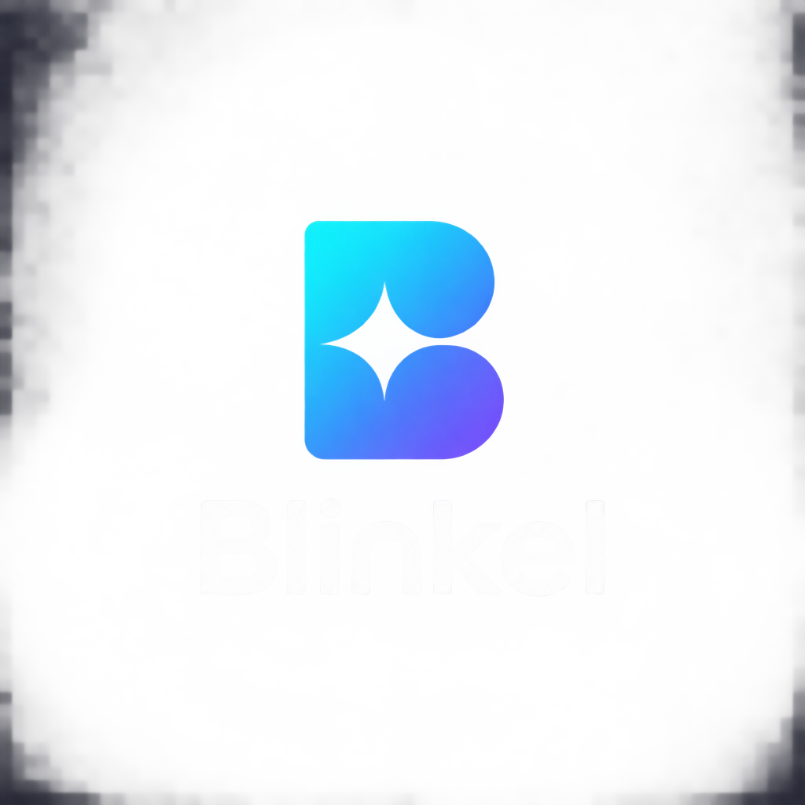

<div align="center">



# Blinkel

### Intelligence at the speed of thought.

A modern, independent AI assistant built to help people  
**learn, create, analyze, explore, and accomplish more.**

<br>


<br>

[Explore the Vision](#-the-vision) •
[Features](#-features) •
[Run Blinkel](#-run-blinkel) •
[Roadmap](#-roadmap) •
[Security](#-security)

</div>

---

## ✦ Meet Blinkel

**Blinkel** is a next-generation conversational AI experience.

It is being designed as an intelligent workspace where people can ask questions, understand difficult topics, improve writing, analyze information, explore creative ideas, work with files, and complete complex tasks through natural conversation.

The project begins with a fast, polished web interface and will gradually grow into a complete AI platform with accounts, cloud history, multimodal input, tools, search, and multiple AI models.

> **Blinkel is not just a chatbot. It is the beginning of an intelligent digital workspace.**

---

## ◈ The Vision

Blinkel aims to make advanced AI feel:

- **Fast**, with responsive and streaming answers
- **Clear**, with polished and readable responses
- **Capable**, with tools for research, writing, analysis, and creation
- **Personal**, with conversation history and user preferences
- **Accessible**, across desktop and mobile devices
- **Responsible**, with security, privacy, and safety built into the platform
- **Independent**, with an original brand and product identity

The long-term goal is to build one place where users can move naturally between ideas, documents, images, research, code, and real-world tasks.

---

## ✨ Features

### Available in the current prototype

- 💬 Modern conversational AI interface
- ➕ New chat creation
- 🗂️ Local conversation history
- 🔎 Conversation search
- 🕶️ Temporary chat mode
- 📎 File attachment interface
- 🎙️ Voice input on supported browsers
- 🌐 Web search mode interface
- 🧠 AI model selector
- 📋 Response copying
- 🔄 Response regeneration
- ⏹️ Generation cancellation
- 🔗 Conversation sharing interface
- 👤 Sign-in and account creation interface
- 📱 Responsive desktop and mobile layout
- 💾 Local browser storage
- 🌌 Original Blinkel visual identity

### Planned capabilities

- Live AI-generated responses
- Streaming text generation
- Secure user authentication
- Cloud conversation synchronization
- Real-time web search
- Source citations
- Image understanding
- Document analysis
- Image generation
- Code execution
- Multiple AI models
- Shared conversations
- Personal preferences and memory
- Free and premium plans

---

## 🖥️ Preview

Blinkel currently includes a complete frontend prototype with:

- A collapsible conversation sidebar
- A responsive AI chat workspace
- Suggested starter prompts
- Attachment and tool controls
- Model-selection dialogs
- Account forms
- Local conversation persistence
- Searchable chat history
- Desktop and mobile navigation

The current assistant responses are placeholders. A production AI backend has not yet been connected.

---

## 🧩 Project Structure

```text
Blinkel/
├── index.html
├── style.css
├── app.js
├── blinkel-logo.png
└── README.md
```

| File | Purpose |
|---|---|
| `index.html` | Main Blinkel interface and application structure |
| `style.css` | Responsive visual design and component styling |
| `app.js` | Chat interactions, local storage, attachments, and interface logic |
| `blinkel-logo.png` | Official Blinkel logo |
| `README.md` | Project documentation |

---

## 🚀 Run Blinkel

Blinkel is currently a static frontend application.

### Option 1: Visual Studio Code

1. Clone or download the repository.
2. Open the project folder in Visual Studio Code.
3. Install the **Live Server** extension.
4. Open `index.html`.
5. Select **Open with Live Server**.

### Option 2: Python local server

Run the following command from the repository directory:

```bash
python -m http.server 8000
```

Then open:

```text
http://localhost:8000
```

### Option 3: Node.js local server

If Node.js is installed, run:

```bash
npx serve .
```

Open the local address shown in the terminal.

> A local web server is recommended. Some browser features may be unavailable when `index.html` is opened directly as a local file.

---

## 🌍 Deploy with GitHub Pages

Blinkel can be published as a static frontend using GitHub Pages.

1. Open the repository on GitHub.
2. Open **Settings**.
3. Select **Pages**.
4. Under **Build and deployment**, choose **Deploy from a branch**.
5. Select the `main` branch.
6. Select the `/ (root)` directory.
7. Save the configuration.

After deployment completes, GitHub will display the public website address in the Pages settings.

---

## 💾 Local Conversation Storage

The current prototype stores conversations in the browser using `localStorage`.

```text
blinkel_conversations_v1
blinkel_active_conversation_v1
blinkel_temporary_mode_v1
```

### Current limitations

- Conversations remain only in the current browser.
- Conversations are not synchronized between devices.
- Clearing browser data removes locally saved conversations.
- Temporary chats are excluded from persistent conversation storage.
- Accounts are currently visual prototypes and are not connected to a backend.

Cloud storage and account synchronization will be added in a later development phase.

## 🗺️ Roadmap

### Phase 1: Foundation

- [x] Establish the Blinkel brand
- [x] Create the official Blinkel logo
- [x] Build the responsive chat interface
- [x] Add desktop and mobile navigation
- [x] Add local 
